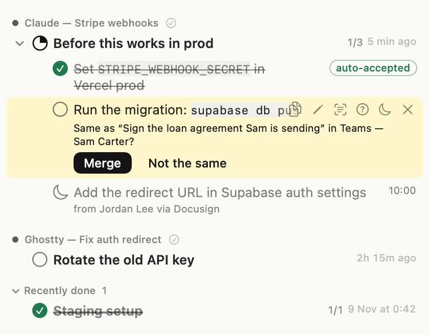

<p align="center">
  
</p>

<h3 align="center">Ten tabs, four Claude sessions, one forgotten step.</h3>

<p align="center">Didja remembers the steps you didn't finish, and ticks them off when you do.<br>
<a href="https://didja.dev">didja.dev</a></p>

---

You're vibe coding in five places at once. Claude gives you a checklist, you do three steps, a new prompt pulls you away, and step four quietly disappears, until production breaks.

Didja is a Mac menu bar app that notices those steps for you:

- **Catch.** Checklists Claude writes for you, commands to run, and "don't forget" lines in email and chat, and what you said you'd do in your own messages, become open items in the menu bar, grouped by where they came from. Asks you sent wait under Waiting On until that person answers.
- **Watch.** As you work, it looks for proof each step is done: the right variable on the right settings page, the command run in a terminal, the reply actually sent.
- **Tick, or ask.** When it is sure, it ticks the step. When it isn't, it asks. A step left hanging gets one gentle reminder.

It works in the apps you already use: Claude, Claude Code in a terminal, ChatGPT, Gemini, Copilot, Codex and other AI tools, Gmail, Outlook, WhatsApp, Teams, Slack and any browser tab (Apple Mail is not supported yet). You can also connect Linear, Jira, Asana, Todoist or Notion.



<!-- Screenshot placeholder: swap for a real capture of the Quick View once one is ready. -->

## Download

**[Download the latest release](https://github.com/didja-dev/didja/releases/latest)** (a signed and notarised `.dmg`).

- macOS 14 or later, on Apple silicon.
- Didja asks for **Accessibility** to read the window you are working in. Screen Recording is optional, and is only used for apps that hide their text.
- Didja checks for updates once a day. You can turn this off in Settings › General.

## Privacy

It reads your screen, so it never sends any of it anywhere.

- **On your Mac only.** Reading, matching and the language model (Apple's on-device model, or a model you run in Ollama if you turn that on) all run locally. No account, no cloud, no analytics.
- **Text, never pixels.** It keeps short pieces of text. No screenshots or video are ever stored.
- **Forgets in 24 hours.** Captured text is deleted after a day at most. Your task list stays, with a few lines kept beside each open task (so you can see where it came from) until it is done.
- **Skips the sensitive stuff.** Password fields, card and bank-account fields, password managers, system password prompts, private browser windows and anything on your exclude list are never read. The exclude list starts with well-known banks, brokerages, payment checkouts and patient portals; remove any you want read, or add your own.
- **Pause any time** from the menu bar or with ⌃⌥P.

The only network traffic is the daily update check (its version only) and, if you connect them, your task tools. If you turn on Let My Own Claude Read Didja, what your Claude reads (masked) goes to your AI provider. **Settings › Privacy** in the app shows what is read, what is kept and where, with the live state of each. The full detail is in [docs/GUIDE.md](docs/GUIDE.md#privacy). Every connection Didja can make, with its host, what it sends and how to turn it off, and how to watch them with LuLu or Little Snitch: [docs/NETWORK.md](docs/NETWORK.md).

## How often it ticks wrongly

A missed tick is cheap; a wrong one is the bug Didja exists to prevent. The benchmark replays made-up sessions through the engine and counts both:

<!-- benchmark:start (written by engine/bench/publish.ts; do not edit by hand) -->
- **Tick precision: 100%.** Of the 33 ticks Didja made across 105 made-up sessions, 0 were wrong. CI fails on any wrong tick.
- **It found 88% of the tasks it should have** (recall), and 98% of the tasks it made were real ones (capture precision). 0 tasks were given to the wrong person. Rules only, no language model.
- The sessions are made up, written to look like real chats, emails, terminals and AI replies, so they show how Didja behaves on those shapes, not how it does on your Mac. How it works: [engine/bench/README.md](engine/bench/README.md).
<!-- benchmark:end -->

## What it costs your Mac

Measured on an Apple M5 Pro (Debug build, 10 minutes of ordinary work): the app uses about 14% of one core and 93 MB of memory, the engine under 1% and about 250 MB. The database grows about 11.5 MB an hour and levels off, because captured text is deleted after a day. Method, all the numbers and how to measure your own Mac: [docs/PERFORMANCE.md](docs/PERFORMANCE.md).

## Build from source

You need Xcode 16+ and [Bun](https://bun.sh).

```bash
# engine tests and type-check
cd engine && bun install && bun test && bunx tsc --noEmit && cd ..

# build the app (bundles the engine) and run the Swift tests
xcodebuild -project app/Didja.xcodeproj -scheme Didja -configuration Debug -derivedDataPath app/build test

open app/build/Build/Products/Debug/Didja.app
```

The project signs with the maintainer's Apple Development team. To build without that certificate, add `CODE_SIGN_IDENTITY=- CODE_SIGN_STYLE=Automatic DEVELOPMENT_TEAM=` to the `xcodebuild` command. macOS will then ask for Accessibility again after every rebuild.

## Your data outlives Didja

The code is MIT and stays MIT. Didja needs no server and no account to work: the update check is optional, and if didja.dev went away Didja would keep working. Your tasks are in one SQLite file whose schema is in [`schema/`](schema), and **Export All Tasks** (Settings › General, or `didja export`) writes every task to a Markdown or JSON file you keep. The whole pledge: [docs/PLEDGE.md](docs/PLEDGE.md).

## Learn more

- [docs/GUIDE.md](docs/GUIDE.md): every feature, keyboard shortcuts, the CLI and privacy in detail
- [docs/ARCHITECTURE.md](docs/ARCHITECTURE.md): how capture, the engine and the app fit together
- [docs/ROADMAP.md](docs/ROADMAP.md), [docs/CHANGELOG.md](docs/CHANGELOG.md), [docs/DECISIONS.md](docs/DECISIONS.md)
- [CONTRIBUTING.md](CONTRIBUTING.md) and [SECURITY.md](SECURITY.md)

## License

MIT. See [LICENSE](LICENSE).
