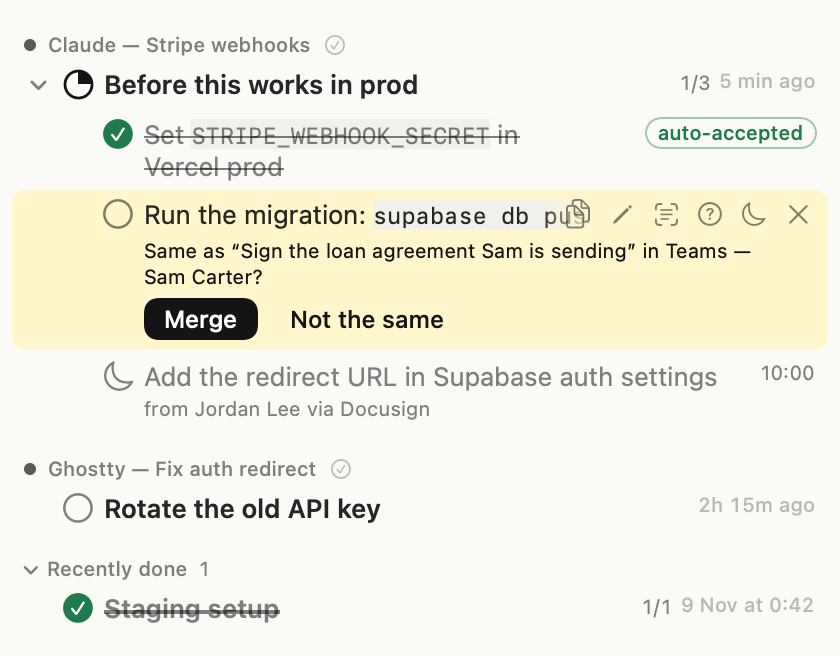
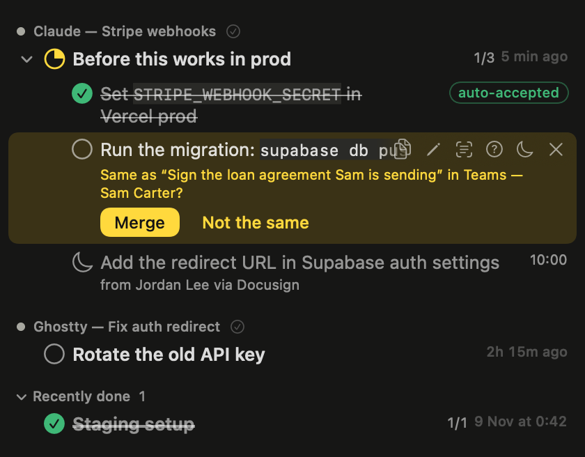
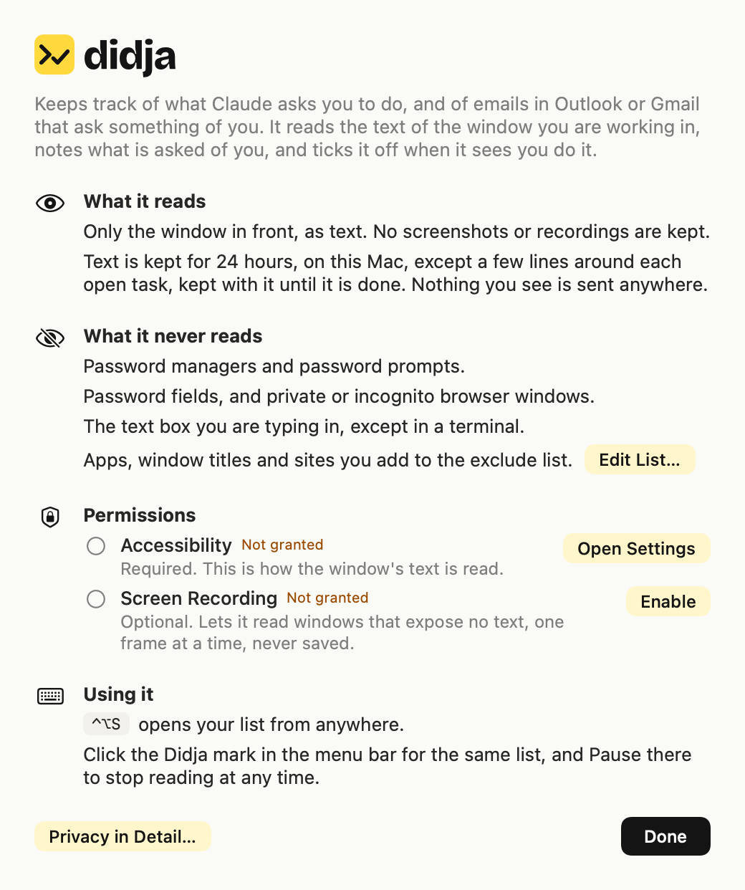

# Using Didja

The full guide: every feature, the layout of the code, building, the CLI and privacy in detail. The short version is in the [README](../README.md).

## Status

Milestone 2 of 6 (see [docs/ROADMAP.md](ROADMAP.md)):

- The native capture layer writes text observations.
- The engine turns numbered checklists that Claude wrote (Claude desktop, claude.ai, Claude Code in a terminal) into tasks.
- When a list's wording does not say whether it is for you ("Next steps:", "To fix this:"), it shows up only once the on-device model (or your Ollama model, if you turned one on) has said it is yours, a few seconds after Claude finishes writing. A list whose steps are Claude's own coding plan (changing functions, files, tests, a schema; "I'll …") is left out without asking. With no model on this Mac, such a list shows up greyed with a **maybe** tag: dismiss it with Not an Action if it is not yours.
- In Claude Code only Claude's own replies count: a list in a tool's output (a file Claude read, `cat` of a doc) or in what you typed is not yours. A step Claude then carries out with its own tools (it runs the step's command, or edits the file a step to change names) leaves your list as **Claude did this itself**; it is never ticked as yours. An editor (VS Code, Cursor, Zed, Windsurf) counts as Claude Code only when Claude Code's own panel is in it, so a CLAUDE.md you have open makes no tasks.
- A task is ticked on its own when its exact markers are seen in the right place: a command run at a terminal prompt (typed and entered, with its output or the next prompt after it, and nothing in that output saying it failed), an env var or URL on the site of the one service the task names. Tasks with nothing exact to look for stay manual.
- Tasks with nothing exact to match ("Check the login flow works") are never ticked for you. When a later screen shows one looks done, the Quick View asks: **Yes, done** or **Not yet**.
- Didja also reads ticked boxes, switches (on or off) and short notices such as "Message sent" or "Pull request #42 merged". A ticked box or a notice that names a task makes Didja ask about it sooner; a box that names it but is not ticked keeps it from asking. None of them ticks a task by itself.
- Which screens it looks at for that: a site or app the task names, one the conversation or email it came from names ("Last steps on GitHub:" makes github.com count for "Set the repo to Public"), a site its email linked to, a place you taught, or, right after you looked at the task's source, a page showing an id from it ("purchase order 4410" on the portal you went to next). A page that only shares a word or two is never asked about. Screens that show an id from the task are looked at first; with the Ollama model on, more screens are looked at each time.
- When such a task is captured, the on-device model writes down once what its done screen would show (where, a phrase like "Approved", the order number), while the conversation or email is still at hand. A screen there that shows it is looked at first; one there that still says it is waiting ("Awaiting your approval"), or lacks the number, is not. Why shows what it is looking for ("Didja is looking for: …"). It is forgotten once the task is done.
- Commands Claude tells you to run ("Check it: `curl ipinfo.io`", "…then run: `brew install jq`") become tasks too, and tick when you run them in a terminal.
- The command you run may differ a little: flags in another order, an extra flag such as `-u` (`git push -u origin main` ticks `git push origin main`), a comment after it, or a time on the right of your prompt. Different arguments, a missing flag, `--dry-run` or `--help` do not count. VS Code, Cursor and Windsurf's own terminal counts too, while you are in it. A command step still open two hours later can be shown to "looks done?" on a terminal where a similar run went well; that only ever asks, even with Accept Automatically on.
- An email open in Outlook for Mac, or in Gmail or Outlook on the web in a browser, that asks something of you becomes a task that says what to do: "Send Dana the updated Q3 numbers", "Update card details on PayPal". If an answer is what is wanted, the Quick View asks you to confirm once your reply in that conversation is seen. If the email links to the page where the thing is done (an approval, a form) and you open that link, the task is ticked when the page then shows it done. A workflow approval (Oracle EBS and the like) whose Approve or Reject link sends a new email with a `Response Action:` line is ticked once that email of yours, with the request's subject, is seen in the same mail app (the Sent view, say). Archive the email and its task leaves the list (dismissed, not ticked): archiving says you no longer need it. Archiving another email about the same matter counts too, when only the tag in front of the subject differs ("Closed: Purchase order 4410" for "Action Required: Purchase order 4410"). A message you sent never becomes a task: in Outlook the app learns your address and name from the window title.
- Didja has two views. The **Quick View** drops down from the menu bar icon (or ⇧⌘J): your open list, to tick and move on. The **Full View** (the **Full View** button in the Quick View's header, or O) is the whole app: tasks by view and source, and **Settings** (General, Connections, Your Names, How It Decides, Exclude List, Privacy) in its sidebar. While it is open Didja is in the Dock; ⌘, opens Settings. **Quick View** (or O) at its top right closes it and opens the Quick View under the menu bar icon; the × button (or Esc) just closes it.
- **Connections…**: connect Linear, Jira, Asana, Todoist or Notion (over each one's MCP server, signing in in your browser; only Linear has been tried with a real account). Choose what comes in (due today or overdue, in progress, to do, backlog) and from which teams; those issues appear under "Linear" with their key; ticking one moves it in Linear to the state you choose (or adds a label). This is the only network use, and only to the tools you connect; nothing read from your screen is sent.
- A chat message in WhatsApp, Teams or Slack that asks something of you becomes a task: "Send Dana Levi the signed contract". In a one-to-one chat any ask counts; in a group only one that tags or names you, or asks every member for their own answer ("everyone please confirm"), never one meant for someone else. Set your name and add the names and nicknames people tag you by, in any language, in **Your Names** in Settings (or `didja names`). An ask waits 10 minutes before it becomes a task, so a conversation you are having live makes none; several asks in one chat are one task, worded after the newest. Your reply after it ticks the task (labelled), unless the reply puts it off ("tomorrow", "I'll check", or the model reads it so); when the model cannot tell, the Quick View asks you. Slack is built from its page markup and has not been tried live.
- Only what is asked of *you* becomes a task. Lists where Claude reports what it did or plans what it will do are skipped, and so are statements inside a list of instructions. Wording decides most cases; Apple's on-device model settles the rest.
- Each checklist is a parent task with its steps nested under it, to any depth: a step's own sub-steps become steps under it. A parent is done when nothing under it is left open; ticking a parent ticks everything under it.
- The Quick View shows the tree. Fold and unfold parents, tick with a click, rename anything (double-click, the pencil, or R), and hover or highlight a row to snooze, dismiss, or ask why it is open or done. ⇧⌘J opens it from anywhere (choose other keys in Settings › General › Keys) and every action has a key.
- Several at once: ⌘A chooses every row on show, ⇧↑/⇧↓ or ⇧-click choose a run of rows, ⌘-click adds or removes one. Then Space ticks them, D (or Delete) dismisses them and S snoozes them for an hour; the same is on the right-click menu. Esc lets go of the choice.
- Copy a row to the clipboard as text with ⌘C, the copy button on the row, or its right-click menu. A step copies as its title; a parent copies with everything under it as an indented checklist (`- [ ]`, `- [x]` for done steps), whether or not it is folded.
- The Full View shows everything by state and by conversation, with a detail pane for the highlighted item.

- A checklist introduced by a long sentence gets a short title from the on-device model; rename it if you prefer your own.
- If a checklist sits unfinished for four hours with nothing ticked, you get one reminder. Turn it off in the Quick View's "…" menu.
- ⌃⌥P pauses and resumes capture from anywhere.
- Go to Source: right-click a task (or press G on a highlighted row) to bring back the window it was captured in, scrolled to its line. A closed browser tab is reopened from its address; a conversation that is not open is opened from the sidebar, and earlier messages are scrolled up to for at most 5 seconds. It stops the moment you move the pointer, press a key (Esc), click, scroll or switch apps, never moves your pointer, and never presses a button, except a sidebar entry that is exactly the conversation's name (with at most a status such as "Running" after it).
- Search the Quick View: click the search bar or press F (or / or ⌘F) and type. The list narrows as you type to the checklists and tasks that mention it, in their own title or in any step. ↓ or Return moves from the search to the matching rows; Esc clears it. While a search hides rows, "tick the whole conversation" is off, so nothing out of sight is ticked. The search is forgotten when the Quick View closes.
- The Full View has the same search, Collapse All, and lists finished work by day.
- Pin the Quick View anywhere: "Pin Quick View (Move and Resize It)" in its "…" menu, or right-click the menu bar icon. It becomes a small window that stays above other windows; drag it by its title bar (to the right side of the screen, say) and drag its edge to make it taller or shorter. The icon, ⇧⌘J and Esc then show and hide it there, and it opens there again after a restart. "Unpin Quick View (Back Under the Icon)", in the same two places, puts it back under the icon.
- Clicking in another app, or switching to one, closes the Quick View, under the icon or pinned. To keep it open while you work elsewhere, turn on "Keep Quick View Open When You Click Elsewhere" in the Quick View's "…" menu (or right-click the menu bar icon). Then only the icon, ⇧⌘J, Esc or its close button hide it.
- Light, dark, or following the system: choose under Appearance in the Quick View's "…" menu.





Nothing leaves the machine.

## Layout

| Path | What |
| --- | --- |
| `app/` | Xcode project: macOS 14+ menu bar app (Swift + SwiftUI, in a status item and popover the app owns), bundle ID `dev.didja.app`, not sandboxed |
| `app/Capture/` | Our own capture layer: Accessibility first, Vision OCR fallback, per-window diff, privacy rules |
| `engine/` | TypeScript on Bun: reads observations from SQLite, writes tasks; compiles to a single binary bundled in the app |
| `schema/` | The shared SQLite schema |
| `docs/` | [Architecture](ARCHITECTURE.md) and [roadmap](ROADMAP.md) |

The app and the engine share one database: `~/Library/Application Support/Didja/didja.db` (WAL mode).

## Build and run

Requires Xcode 16+ and [Bun](https://bun.sh).

```bash
xcodebuild -project app/Didja.xcodeproj -scheme Didja -configuration Debug -derivedDataPath app/build build
open app/build/Build/Products/Debug/Didja.app
```

On first launch a welcome screen says what is read and what never is, and shows the two permissions with their state: **Accessibility** (required) and Screen Recording (optional, only for the OCR fallback). With Screen Recording granted, macOS (15 and later) itself now and then asks you to confirm that Didja may "bypass the system private window picker". That alert is the system's, shown the first time the fallback reads a window after macOS decides to check again (and possibly after an update), not at every launch. Don't want it? Turn off "Read windows without accessibility text" in Settings › General: the fallback stops and Didja never asks for a frame. It is always available under "How Didja Works…" in the Quick View's "…" menu. The app starts the bundled engine itself.



The project signs with an Apple Development certificate (team `STFWXX7FA8`), so the Accessibility grant survives rebuilds. To build without that certificate, pass `CODE_SIGN_IDENTITY=- CODE_SIGN_STYLE=Automatic DEVELOPMENT_TEAM=` to `xcodebuild`; macOS will then ask for Accessibility again after every rebuild.

## CLI

```bash
cd engine && bun install
bun run cli observations --tail   # live view of what capture is writing
bun run cli tasks                 # open tasks
```

`bun run cli status` says whether capture is running. `bun run cli snooze <id> 2h` hides a task for a while (`30m`, `3d`, `tomorrow`). `bun run cli why <id>` shows what would tick a task and what has been seen so far. Tasks marked `auto` in the list can tick themselves.

`bun run cli notyet <id>` answers a "looks done?" with no.

`bun run cli quality` says how Didja is doing on this Mac over the last 7 days (`--days N` for another span, `--json` for the app): per kind of source (Claude, Claude Code, Email, Chat, Added by you, Connected tools), how many tasks were made; how many Didja ticked for you and by what (a command run, a link, a setting, a file, a screen, a reply, a connected tool, "looks done" accepted automatically); how many "looks done?" were asked and answered yes, not yet or not at all; how many you ticked yourself or showed done in Didja Missed This; how many were dismissed, marked Not an Action or cleared by Fresh Start; and how many you reopened after Didja ticked them (the wrong ticks). Counts only, no titles or text, and never sent anywhere. Settings › General › **How Didja Is Doing** shows the same numbers for the last 7 days. They are counted from the version that started recording them (SCR-73); earlier tasks are not in them.

Other commands: `tasks --all`, `tasks --json`, `poll` (one pass), `run` (loop), `done <id>`, `done-all <id>` (everything open from the same conversation as that task), `dismiss <id>`, `reopen <id>`. The same CLI is inside the app bundle at `Didja.app/Contents/Helpers/didja`.

## Privacy

- **Didja Missed This…** (right-click a task, or X): when you did something and Didja did not notice. **1** pick where you did it, **2** pick the screen that shows it done (your own screens, as they are) and click **This Shows It Done**: the task is ticked, the site is remembered for steps like it, and screens already kept there are checked again for the other steps, which may show "looks done?" at once. **3** let your own Claude help (it offers to set it up), or report it to Didja's makers (masked). `didja missed places` lists the sites you taught and `didja missed forget <id>` forgets one.
- **Folding:** ← on a step goes to its parent, ← again folds it; → unfolds, → again goes into it; ⌥← and ⌥→ fold or unfold everything; **H** shows or hides Recently done.
- **Keys:** ⇧⌘J opens Didja from anywhere. In the Quick View, **M** (or **.**) opens the "…" menu, which works with arrows, Return and typing; **⌘1–⌘9** open your canvases (numbered in the strip under the header, by when you made them), **⌘N** a new one, **⌘,** Settings, **⌘⇧⌫** Fresh Start, **⌘⇧R** Report a Problem. Hold **⌘** to see the numbers light up and the ⌘ keys listed.
- The Quick View's "…" menu: **Canvases**, **Fresh Start…** and **Report a Problem with This Window…** at the top, then **View** (Focus, Sort, Appearance, pin and keep open), **Tasks** (Looks Done, Older Messages, reminders), **Privacy** (Privacy…, Exclude List…, Keep Captured Text For, Forget Captured Text Now…), **Help** (How Didja Works…, How It Decides…, Check for Updates…), then **Settings…** (Launch at Login, Connections, Your Names and the rest) and Quit.

- No third-party screen recorder. Capture is built only on Apple APIs.
- Only the focused window is ever read.
- No screenshots or video are stored. An OCR frame is processed in memory and dropped.
- Text only, deduplicated per window. Observations expire after 24 hours. The one exception: a few lines around each open task (at most seven) stay with it, so you can see how it looked where it was captured (the row's preview button, or V). They are deleted when the task is done or dismissed, with Forget Captured Text Now, and when you exclude that window.
- Password managers and system password prompts are never read; neither are secure text fields or private/incognito windows. Add your own apps, window titles and sites under **Exclude List…** in the Quick View's menu: a change applies at once, and text already kept from anything you add is deleted. The list is the file `~/Library/Application Support/Didja/exclude.json`, which you can also edit by hand.
- **Focus** in the Quick View's menu narrows the list to one app (only Claude, only Claude Code, only Gmail…); **Sort** switches between grouping by source and latest activity first.
- **Looks Done** in the Quick View's menu: **Ask Me** (the default) shows "looks done — confirm?" and waits for your yes; **Accept Automatically** ticks it for you and labels it "auto-accepted". Reopen one that was wrong and it is never ticked from that place again.
- **Older Messages** in the Quick View's menu: **Capture Tasks From Them** (the default) works as before; **Ignore Them (New Messages Only)** leaves out mail and chat messages sent before capture started (when Didja launched, or when you last pressed Resume). Their dates say so; a Claude reply has no date, so it is always read, even one that came while you were in another window or one you scroll back to. Tasks you already have are not touched.
- **Teach it.** Right-click a task, or use the Full View: **Not an Action** dismisses it, never captures the same wording again, and shows the model the case from then on; **Not Done** reopens a task that was auto-accepted by mistake and teaches the "looks done" question. Not an Action on a chat ask teaches the chat question; renaming a checklist teaches how checklists are titled; **Yes, done** is remembered as a confirmation. **How It Decides…** in the Quick View's menu shows the instructions the on-device model reads for each of its five jobs, in plain English: copy them, have any AI improve them, paste them back, or reset to the built-in text. The **?** there explains how. When your version works better, **Propose Upstream…** beside it makes a file for the maintainers: your change against the built-in text, and only the corrections you tick (none by default, since they hold your tasks' wording). They try it on made-up examples (`bun eval/compare.ts`) and take it only if it gets more right with no new wrong ticks.
- **Updates:** Didja checks didja.dev once a day for a new version and offers it in the standard macOS update window, with the release notes (Install Update, Remind Me Later, Skip This Version). **Check for Updates…** is under Help in the Quick View's menu; Settings › General turns the daily check off. The version you are running ("Didja 0.4.1 (5)": the version, then the build) is the last line of the Quick View's "…" menu, and in Settings › General. An update is installed only if its signature matches the key built into the app. The request carries only the app's version.
- **Report a Problem with This Window…** in the Quick View's menu: when Didja misreads an app, click in that app's window, then choose it. It shows the whole file it would make, line by line: the window's outline (roles, ids, class names), what capture keeps from it, what Didja kept from that app and the tasks it made, with every letter as x and every digit as 0 except the app's own label words. Click a line to show it as it is. Then **Save…**, **Copy**, or **Open a GitHub Issue…** and attach the file. Didja sends nothing itself. A window on your exclude list has nothing to report.
- **Use a model in Ollama** (Settings › General, off by default): if you run [Ollama](https://ollama.com) on your Mac, Didja can ask one of its models first about emails ("does this ask me something?") and "looks done?", and Apple's model when Ollama does not answer. It is shown the same text as Apple's model and reached only at 127.0.0.1. Pick the model in the same row. On Didja's made-up samples qwen3.8 got 14/14 emails and 10/10 "looks done?" with no wrong tick, against 11/14 and 9/10 with one for Apple's model; it takes about two seconds an answer and needs memory while it runs. `didja local-model on <model>`, `off` and `status` do the same from the command line; `bun eval/ollama.ts <model>` measures another model.
- **Let My Own Claude Read Didja** (Settings › General, off by default): your own Claude Code or Claude Desktop, set up with `didja mcp`, can read the reports you give it (**Give to My Claude** in Report a Problem), the text Didja kept with every letter and digit masked, and the app profiles, and draft a profile with you in its own folder. Once it has found why something was missed, it offers to report it to Didja's makers as a GitHub issue: Didja drafts it, masked, with your Claude's explanation, and you post it yourself with one click (or say yes to your Claude posting that exact text). What it reads goes to your AI provider; every call is logged and counted in Privacy. How to set it up, and the rules your Claude follows: [docs/AGENTS.md](AGENTS.md).
- **Canvases**: drag a task (or several chosen) from the list onto a canvas, or right-click › **Send to Canvas**, to put it on a floating page that stays open while you work; a checklist goes with its steps. Click anywhere on it and type: Enter adds the line as a task; `# ` makes a heading, `- ` a bullet, `> ` a note, `[x] ` a task already done, and Tab or two spaces indent it (Shift-Tab back). Notes show Markdown (bold, italic, code, links). From the keyboard: ↑ from the empty line goes into the list; ↑↓ move, Space ticks, Tab / ⇧Tab indent, ⌥↑↓ reorder, Return edits in place, Y / N answer "looks done?", ⌘⌫ takes an item off, Esc goes back to typing, ⌘W closes. Its tasks tick and show "Looks done?" as in the list. Export as Markdown or text. **Canvases** in the Quick View's menu opens one or makes a new one.
- **Fresh Start…** in the Quick View's menu marks every open task done for a clear list, after asking; nothing is deleted, and **Undo Fresh Start** (there for a day) brings them back. My List stays.
- **My List**: say "Hey Siri, add to Didja", then what. It also works from the Shortcuts app (**Add to My List**) and `didja keep <title>`. A My List task stays until you tick it: Didja never ticks it from what it sees.
- **Privacy…** in the Quick View's menu explains what is read, what is kept and where, what the on-device model is shown, and that nothing leaves the Mac, with the live state of each.
- Captured text is kept for 24 hours at most. Choose 1 or 6 hours under **Keep Captured Text For** in the same menu, or delete all of it at once with **Forget Captured Text Now…** (it asks first). Tasks already found stay.

  ```json
  { "bundleIds": ["com.mybank.app"], "windowPatterns": ["payroll"], "urlPatterns": ["mybank\\.com"] }
  ```

  If that file is malformed, capture refuses to start.
- The text field you are typing in is not read, so drafts are not stored. Terminals are the exception, because a terminal is one big focused text field.
- Capture can be paused from the menu bar.
- When wording alone can't tell whether a list is for you, Apple's on-device language model is asked. It runs on this Mac; the cloud variant of that framework is never used.
- Nothing leaves the device. From Milestone 4, an explicit escalation call may send a minimal, redacted snippet.
